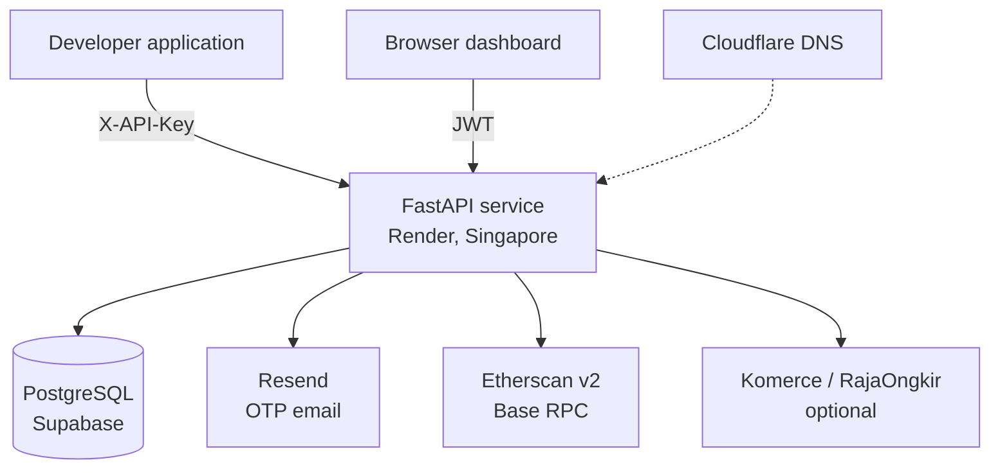
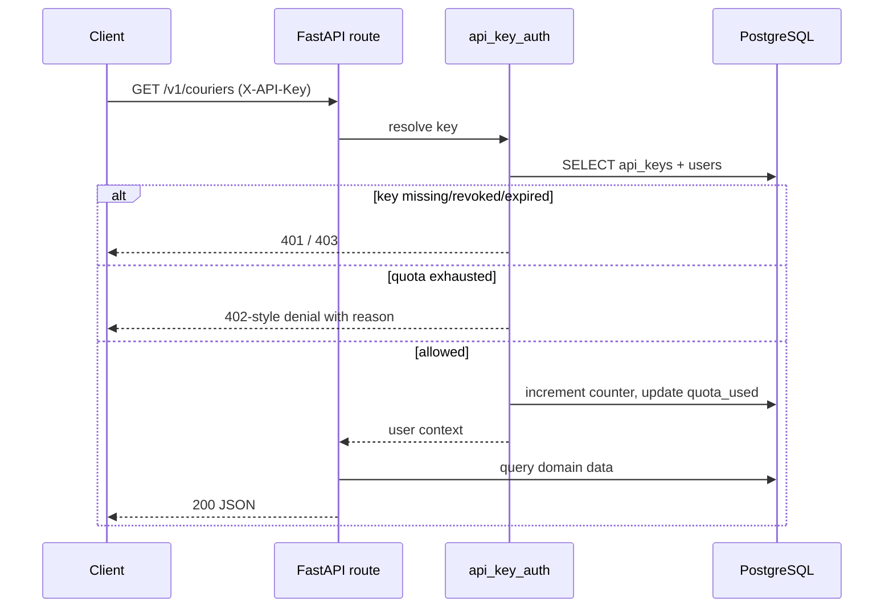
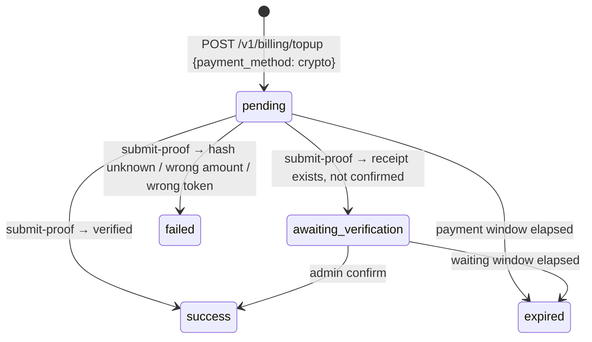
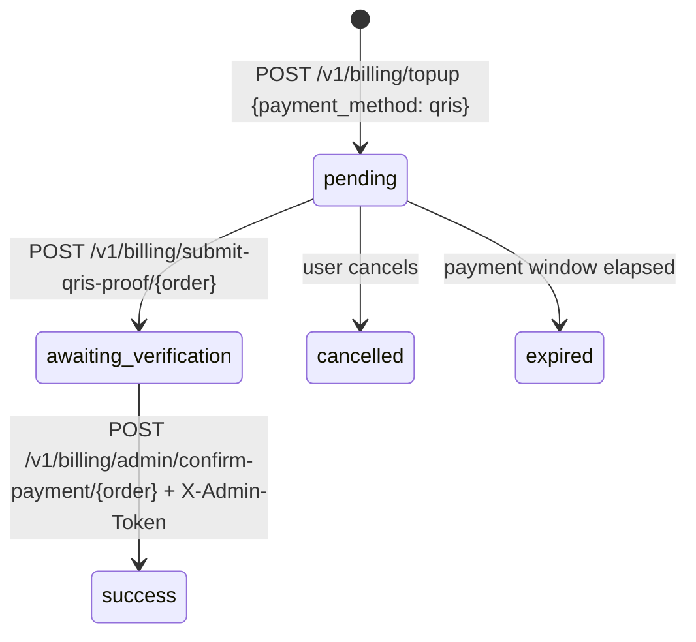
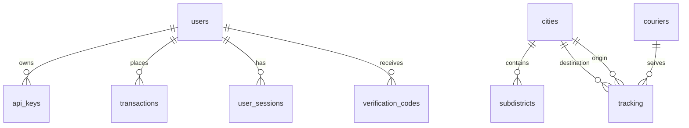

# Architecture

This document explains how ShipStream is put together: the modules, the data model, the request
lifecycle, and the two payment verification paths.

## 1. System context

The application tier is stateless. All state lives in PostgreSQL; secrets come from environment
variables. That is what makes the single-service deployment viable and allows the web tier to be
restarted or replaced at any time.

## 2. Module map

| Path | Responsibility |
|---|---|
| `app/main.py` | App factory: routers, CORS, rate-limit handler, static mounts for the dashboard |
| `app/database.py` | Engine/session factory; picks SQLite or PostgreSQL from `DATABASE_URL` |
| `app/models/base.py` | SQLAlchemy models for users, keys, cities, couriers, tracking, transactions |
| `app/routers/auth.py` | Registration, OTP verification, login, resend with backoff |
| `app/routers/apikey.py` | Key generation, listing, per-key settings, revocation |
| `app/routers/logistics.py` | Cost quotes, cheapest-courier recommendation, shipments, tracking, labels |
| `app/routers/billing.py` | Top-up orders, history, crypto proof, QRIS proof, admin confirmation |
| `app/routers/profile.py` | Profile read/update, email change with OTP |
| `app/routers/telegram_bot.py` | Optional Telegram integration mounted under `/api/v1` |
| `app/utils/api_key_auth.py` | Resolves `X-API-Key`, enforces quota and IP allow-list |
| `app/utils/security.py` | Password hashing (argon2), JWT creation/verification |
| `app/utils/security_utils.py` | OTP generation, captcha check, verification-code persistence |
| `app/utils/crypto_validator.py` | On-chain verification of a submitted transaction hash |
| `app/utils/env.py` | Typed environment access with placeholder detection |
| `app/utils/limiter.py` | SlowAPI limiter configuration |
| `alembic/` | Migration environment and versioned schema changes |
| `start.py` | Boot sequence: migrate → seed if empty → serve with uvicorn |
| `frontend/` | Landing page and dashboard (vanilla JS, no build step) |

## 3. Request lifecycle (metered call)

Design notes:

- Keys are opaque random strings, not derivable from the user id.
- Quota is a property of the **account** (`users.quota_limit` / `quota_used`), not of an individual key,
  so every key of a team draws from one pool.
- `api_keys.total_requests` is kept for per-key analytics while the account-level counter drives billing.
- `api_keys.status` supports `active`, `suspended`, `limited`; the billing flow can reactivate a key when
  a payment lands.

## 4. Authentication and OTP

1. `POST /auth/register` creates an inactive user (`is_verified = false`), stores an OTP in
   `verification_codes` with a 15-minute expiry, and emails it through Resend.
2. `POST /auth/verify-code` matches the code, checks expiry, and flips `is_verified`.
3. `POST /auth/login` issues a JWT (`sub`, `jti`, `exp`) and records the session in `user_sessions`
   so it can be revoked.
4. Login requires a captcha header; verification fails open only when `CLOUDFLARE_SECRET` is unset.

With `DEBUG_MODE=true` the app exposes `GET /auth/debug/otp/{username}` so OTP flows can be exercised
without a mailbox. **This endpoint leaks codes and must be disabled in production.**

Resend attempts are limited per user (`resend_count`, `security_resend_count`) with time windows to
prevent mail-bombing.

## 5. Payment state machines

### Crypto (USDC on Base)

Verification order inside `crypto_validator`:

1. Ask the explorer (`eth_getTransactionReceipt`); if a receipt exists, validate it.
2. Otherwise ask the RPC; if there is still no receipt, probe `eth_getTransactionByHash`.
   A hash unknown to the node is **failed** — it can never become a valid payment.
3. A receipt is accepted only if: status is `0x1`, a `Transfer` log exists for the expected token
   contract, the recipient equals `MY_CRYPTO_WALLET`, and the amount is within tolerance of the
   expected USD value.

Every outcome writes `status_reason`, so the dashboard can explain the result instead of showing a
generic "invalid".

### QRIS (static)

There is no gateway callback: the merchant QR is a static EMVCo payload served from
`frontend/assets/img/qrcodes/`, and settlement is confirmed by a human holding `ADMIN_CONFIRM_TOKEN`.
This keeps the flow free of per-transaction fees while remaining auditable, because the order, the
payer note and the approval are all persisted.

## 6. Data model

| Table | Purpose | Notable columns |
|---|---|---|
| `users` | Accounts and quota pool | `quota_limit`, `quota_used`, `is_verified`, `preferences` |
| `api_keys` | Issued credentials | `key`, `status`, `total_requests`, `ip_whitelist` |
| `transactions` | Top-up orders and payments | `order_id`, `payment_method`, `status`, `tx_metadata`, `expires_at` |
| `tracking` | Shipments and history | `awb`, `status`, `history` (JSON), sender/receiver blocks |
| `cities`, `subdistricts`, `couriers` | Reference data | `rajaongkir_id` links to the external provider |
| `user_sessions` | Revocable JWT sessions | `jti`, user agent, timestamps |
| `verification_codes` | OTP records | `code`, `channel`, `type`, `expires_at` |
| `alembic_version` | Migration head | — |

`tx_metadata` is a JSON document, which is what lets a single table carry both payment shapes
(wallet/chain/expected amount for crypto, image path/merchant for QRIS) without schema churn.

## 7. Security controls

| Control | Implementation |
|---|---|
| Password storage | argon2 via passlib |
| Session integrity | Signed JWT with `jti` recorded in `user_sessions` for revocation |
| API authentication | Opaque keys, revoked/suspended states rejected in the request path |
| Abuse prevention | SlowAPI rate limits, login backoff, resend windows, captcha on auth routes |
| Admin actions | `X-Admin-Token` shared secret on payment confirmation |
| Data exposure | RLS enabled on every public table; `anon`/`authenticated` roles denied outright |
| Secret handling | Environment variables only; `.env` ignored; no credentials in git |
| CORS | Configurable allow-list via `ALLOWED_ORIGINS` (defaults to same-origin in production) |

## 8. Degradation matrix

| Missing dependency | Behaviour |
|---|---|
| `RAJA_ONGKIR_API_KEY` | Cost quotes fall back to locally seeded rate data |
| `RESEND_API_KEY` | OTP is logged instead of emailed; debug endpoint still works |
| `ETHERSCAN_API_KEY` | Verification falls back to the public Base RPC |
| `MY_CRYPTO_WALLET` unset | Uses the wallet baked into the code — **set it in production** |
| `QRIS_IMAGE_URL` unset | Falls back to the placeholder SVG; the UI warns when the image cannot load |
| Redis unavailable | Rate limiting stays in-process (`memory://`) |

## 9. Extension points

- **Webhooks**: `tracking.history` already stores status transitions; a delivery queue can be added
  behind the same model.
- **Horizontal scale**: move quota counters to Redis and keep the app stateless.
- **Additional payment providers**: `payment_method` is a free-form string; a new branch in
  `create_topup` plus a verifier is enough to add one.
- **Additional couriers**: add rows to `couriers` and map provider codes in `logistics.py`.
