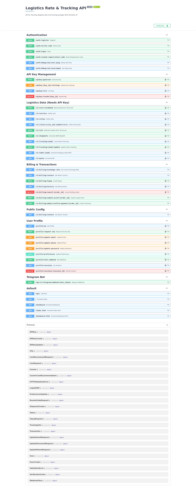

# Documentation

Start with the abstract if you want the whole picture in one page, then dive into the area you need.

| Document | Read it when you want… |
|---|---|
| [ABSTRACT.md](ABSTRACT.md) | A one-page summary of the product, its scope and its results (EN + ID) |
| [ARCHITECTURE.md](ARCHITECTURE.md) | Module map, data model, request lifecycle, payment state machines |
| [API_GUIDE.md](API_GUIDE.md) | A guided walkthrough of registration, keys, metered calls and billing |
| [ENDPOINTS.md](ENDPOINTS.md) | A quick endpoint index |
| [DEPLOYMENT.md](DEPLOYMENT.md) | The full Render + Supabase + Cloudflare + Resend runbook |

Interactive reference: `/docs` (Swagger) and `/redoc` on any running instance.

